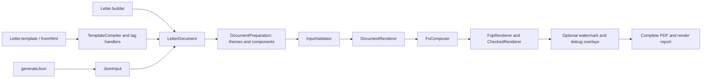

# Working on Letter Generator

Use JDK 17 and the checked-in Maven Wrapper. Run `./mvnw spotless:apply` before `./mvnw clean verify`. `verify` enforces formatting, `-Xlint:all -Werror`, tests, and Checkstyle.

## Where to start reading

Start with [Letter](src/main/java/com/nsdev/lettergenerator/Letter.java) and [LetterPdfGenerator](src/main/java/com/nsdev/lettergenerator/LetterPdfGenerator.java). The first creates builders; the second validates a completed model and renders PDF bytes. Building a model and rendering it are separate operations.



Follow these paths according to the code you are changing:

1. **Java construction.** [LetterBuilder](src/main/java/com/nsdev/lettergenerator/builder/LetterBuilder.java) collects ordered body content and replaceable regions. Its `build()` resolves final dimensions and returns the immutable [LetterDocument](src/main/java/com/nsdev/lettergenerator/model/LetterDocument.java). Model constructors supply defaults and copy collections/images; the full document is validated when generation is requested.
2. **HTML construction.** [HtmlLetterBuilder](src/main/java/com/nsdev/lettergenerator/builder/HtmlLetterBuilder.java) owns source, values and assets. [TemplateCompiler](src/main/java/com/nsdev/lettergenerator/internal/template/TemplateCompiler.java) parses the root, substitutes literal values, reads page settings and dispatches the registered region handlers. A handler configures the same Java builder used by ordinary Java construction. Nested paragraphs, inline styles, tables and images are converted by `internal.markup`. Compilation produces a model, never Java source code.
3. **JSON construction.** [JsonInput](src/main/java/com/nsdev/lettergenerator/internal/json/JsonInput.java) performs strict JSON-to-model mapping. It rejects unknown fields, duplicate keys and trailing content. It then shares the same model validation/rendering path as the other APIs.
4. **Validation.** `DocumentPreparation` first resolves document-local role/named styles and reusable components into ordinary model values. [InputValidator](src/main/java/com/nsdev/lettergenerator/internal/validation/InputValidator.java) coordinates page geometry, styles/fonts, block structure, fixed-box collisions, signature configuration and watermark input checks. Helpers preserve field paths such as `sections[0].blocks[1]`. This stage cannot determine actual pagination or painted glyph bounds; those require rendering.
5. **Rendering.** [DocumentRenderer](src/main/java/com/nsdev/lettergenerator/internal/render/DocumentRenderer.java) orchestrates the engine stages. [FoComposer](src/main/java/com/nsdev/lettergenerator/internal/render/fo/FoComposer.java) serializes the model into XSL Formatting Objects, an XML layout vocabulary. [FopRenderer](src/main/java/com/nsdev/lettergenerator/internal/render/fop/FopRenderer.java) invokes Apache FOP, the engine that lays out that document and creates PDF bytes. [CheckedRenderer](src/main/java/com/nsdev/lettergenerator/internal/render/fop/CheckedRenderer.java) checks actual glyph/underline ink and records the page masters selected by FOP.
6. **Acceptance and decoration.** Engine results are internal until diagnostics are accepted. A positive signature reservation permits one retry for body overflow or a missing reserved final-page master. Other failures are terminal. Only after layout succeeds does [WatermarkProcessor](src/main/java/com/nsdev/lettergenerator/internal/render/watermark/WatermarkProcessor.java) optionally use PDFBox to prepend watermark content to selected pages.

### Finding the owner of a change

| Change or question | Start here |
| --- | --- |
| Public fluent calls, append/replace behavior | `builder.LetterBuilder`, `builder.TableBuilder`, `builder.HtmlLetterBuilder` |
| Deferred content creation, resolution and region-style overlays | `internal.builder.content`: sealed `ContentPart`, `ContentParts` factory, four package-private records, and `ContentPartStyles` |
| Shared plain-text conversion or PNG/JPEG fitting | `internal.content.PlainText`, `ImageBlocks` |
| Shared letter/watermark defaults or image/color rules | `internal.defaults.*`, `internal.content.ImageFormat`, `internal.style.RgbColors` |
| Meaning of a field, default or physical unit | The record/enum in `model.*`; its Javadoc documents components and validation timing |
| New top-level HTML region | `internal.template.TemplateTagRegistry` and the corresponding `*TagHandler` |
| Nested HTML tags or CSS properties | `internal.markup.HtmlBlocks`, `InlineReader`, `HtmlTables`, `HtmlStyles` |
| Header placement, logo gaps, reserved zones | `internal.builder.HeaderLayout`, `LetterRegions`; `model.layout.*` |
| Text spacing, table painting, page-master XML | `internal.render.fo` |
| Unexpected extra page or rejected/clipped glyphs | `DocumentRenderer`, `FopRenderResult`, `CheckedRenderer` |
| Registered fonts or allowed resource loading | `internal.font`, `internal.render.resource.ResourceUris`, `internal.render.fop.FopConfiguration` and its package-private `MemoryResourceResolver` |

Each production package has a `package-info.java` describing its role and neighboring components. Read the class overview first, then the method contract: defaults, units, null behavior, mutation/ownership and failure timing are documented where the operation is defined. Constants belong to the class that owns their meaning.

### Package boundaries

| Package | Responsibility |
| --- | --- |
| Root, `builder`, `signature`, `font`, `exception`, `model.*`, `theme`, `component`, `diagnostics`, `render` | Supported application contract: entry points, fluent construction, signature parts, font selection, failures and immutable document values |
| `internal.builder` | Builder-specific header geometry and fixed-region assembly |
| `internal.builder.content` | Deferred content that resolves against final builder settings |
| `internal.content` | Immediate text/image conversion shared by builders, signature parts, watermark factories and markup readers |
| `internal.defaults` | Domain-specific default policies that multiple input APIs must share |
| `internal.template` | Whole-letter HTML parsing, placeholder binding and region handlers |
| `internal.markup` | Supported nested block/inline HTML, CSS and named image assets |
| `internal.json` | Strict JSON-to-model input mapping |
| `internal.composition` | Document-local named/role style resolution and cycle-safe component expansion before validation |
| `internal.table` | Span grid occupancy and cell appearance/inner-width rules shared by parser/validator/renderer |
| `internal.validation` | Semantic model validation with document-field paths |
| `internal.layout`, `internal.style` | Shared geometry/units and effective style resolution |
| `internal.font` | Immutable font registrations and built-in font-family handling |
| `internal.render`, `.fo`, `.fop`, `.watermark` | Render orchestration, FO serialization, FOP integration and PDF decoration |
| `internal.render.resource` | Private resource URI vocabulary shared by FO composition and FOP configuration |
| `internal.xml` | Engine-independent XML writing and character rules |
| `internal.util` | Pure argument checks and collection snapshots |

Keep dependencies directed toward shared model values and leaf helpers. Model factories, signature parts and markup readers may use `internal.content`; they must remain independent of builder-specific state and renderer integration. Rendering packages own engine-specific types. The hardened FO transformer and memory resource resolver have package-private visibility inside `internal.render.fop`, where they are used. Public visibility within `internal` is only for communication between library packages and does not make those types supported application APIs.

The `builder`/`internal.template` package cycle is deliberate: `HtmlLetterBuilder` delegates HTML compilation, and template handlers assemble the result through `LetterBuilder`. The concrete builders have distinct roles; the compiler never depends on `HtmlLetterBuilder`. This keeps the HTML path on the same region geometry and immutable snapshot rules as Java construction. Revisit this relationship if document assembly gains another independent implementation; a separate forwarding layer would currently duplicate the builder surface.

### Browsing and checking Javadocs

The Maven Javadoc Plugin generates the API website and attaches its JAR during `package`, `verify` and `install`. Use JDK 17 for the project's acceptance build. Documentation warnings and errors fail the build; source/HTML encodings are UTF-8 and Javadoc targets Java 17.

```sh
./mvnw javadoc:javadoc                      # Public API website
./mvnw -Pinternal-javadocs javadoc:javadoc   # Full contributor website, including private helpers
```

Open `target/apidocs/index.html` for the public API or `target/internal-docs/apidocs/index.html` for the contributor view. The normal website and `target/letter-generator-1.0.0-SNAPSHOT-javadoc.jar` exclude implementation packages under `internal`. The attached JAR keeps that public scope even if the contributor profile is active. Full internal documentation is for navigating implementation; it does not extend the supported application contract.

Both commands work offline with `-o` once the plugin and dependencies are cached. Automatic remote JDK documentation links are disabled to keep generation independent of external documentation servers. Generated websites stay under the ignored `target` directory. Update method and package documentation when their contracts change; comments must describe current behavior rather than proposed features.

`Diagnostic` uses `@serial exclude` to avoid Java 17 doclet warnings about its generated private record fields when generating public documentation. Its public record components remain fully documented, and serialization behavior is unchanged. The record's class documentation describes its serialized values; do not weaken global doclint or warning checks to work around this case.

## Conventions

- Four-space AOSP Java formatting, explicit imports, and braces on control-flow bodies. The formatter includes tests and examples; Checkstyle includes production and test source.
- Keep the supported contract in the root entry points, `builder`, `signature`, model subpackages, `font`, and `exception`. Do not expose engine types through public signatures. Everything under `internal` may change independently of that contract.
- Put a domain constant beside its owner: paper dimensions on `PageSize`, default styles on `ResolvedStyle`, physical conversions on `Units`, glyph tolerance on the glyph checker. XML element/property names and field paths remain readable schema vocabulary. Do not replace obvious arithmetic with meaningless constants.
- Keep one responsibility per class. Composition, page/master layout, block/style serialization, engine configuration, resource access, validation, and post-processing are separate units. Avoid cyclic package dependencies.
- Use structured XML serialization. Document content is always data. Resource URIs are generated internally and resolved through the per-call memory allowlist.
- Catch expected input errors narrowly. Engine boundary wrappers preserve causes. Recovery decisions use diagnostic types and context, never matching localized exception messages.
- Preserve immutable ownership of lists, images, and loaded font bytes. Mutable engine state belongs to one generation call. Array-backed value records must implement content-based equality and hashing.
- Reuse fixtures from `src/test/java/com/nsdev/lettergenerator/fixtures`, not from test classes. Write regressions around observable behavior. Fixture numbers remain literal to keep expected values independent of production constants.

New dependencies, build plugins, and formatting engines must have pinned versions. The narrow raw-list suppression on the FOP callback exists because the pinned upstream API uses that signature; it is not a general warning exemption.

### Literal and constant ownership

Extract a literal when its name explains a policy, physical conversion, protocol identifier or non-obvious bound. Share it when multiple callers must agree on that same meaning. Use the existing owner first: `Margins.defaults()` supplies default page insets, `StandardFontFamilies` supplies built-in family identifiers, and `Units` supplies physical conversion methods.

Shared Java/HTML region dimensions belong to `internal.defaults.LetterLayoutDefaults`; shared watermark image bounds and opacity belong to `WatermarkDefaults`. Keep independent defaults separate even when their current numbers match: a signature image's fitting height, a reserved signature zone and page margins can all be 20 mm for different reasons. Defaults used by one class stay private there. `ImageFormat` owns supported image identifiers and byte signatures; `RgbColors` owns the common normalized color predicate, while HTML-specific color vocabulary remains local.

An argument name such as `ArgumentChecks.required(value, "block")` describes the failing argument. It does not share a policy with an FO `block` element. Keep short local diagnostic labels, error sentences, schema field names, markup tags and CSS properties readable at their call sites. A global string dictionary would couple unrelated meanings; naming every zero, index or half-width calculation would obscure the calculation. Test fixtures and expected values remain independent literal inputs rather than importing production policy constants.

Convenience builders compile to the existing immutable model; keep rendering in the shared engine. Use typed methods rather than `Object...`, preserve insertion order and immutable build snapshots, and keep default dimensions beside their owning builder/type. Plain body text distinguishes line breaks, paragraphs and explicit page breaks; page breaks belong only in body sections.

Template markup uses jsoup for structure and map-only StringSubstitutor for parsed text/attribute values. Preserve literal value ownership, reject unsupported constructs with locations, and route every region through the existing block/renderer contract. Keep internal.markup independent of public builders; internal.template performs document composition. Template footers and headers support the same styled text/image/table blocks as the body. Preserve explicit style scopes and semantic defaults until shared composition preparation resolves named styles; copying paragraph appearance into every text run breaks theme inheritance.

## Adding a template region

`TemplateCompiler` coordinates root parsing, placeholder binding, page options and handler dispatch. Top-level tags inside `letter` are compiled by stateless `TemplateTagHandler` implementations in `internal.template`: `MainTagHandler`, `HeaderTagHandler`, `FooterTagHandler`, `LogoTagHandler`, `SignatureTagHandler` and `WatermarkTagHandler`.

To add a top-level tag to the library:

1. Implement `TemplateTagHandler` in the same package. Return the lowercase tag name from `tagName()`; override `required()` only when every letter must include it.
2. In `handle(Element, TemplateContext)`, validate the tag's attributes and content with `MarkupSupport`, then contribute to the per-call builder. Keep its defaults and tag-specific rules in this handler. Use `TemplateBlocks` for existing styled text/image/table content and `TemplateImages` for a single-image region.
3. Add one handler instance to `TemplateTagRegistry.standard()`. Registration order defines execution order, independently of source order. Preserve the logo's early sizing before header layout. The registry derives its supported vocabulary from registrations and rejects unknown tags, duplicate region identities, missing required regions and duplicate handler registrations. Header/footer identities include their page selector; override `regionKey(Element)` for another region that intentionally permits disjoint variants.
4. Add tests for the new region's observable model/PDF output, invalid inputs, styles/assets and interactions with existing regions. Update the supported markup instructions in README.md.

Handlers receive `TemplateContext` for the current builder, parsed `TemplatePage` and named assets. Do not retain or mutate input nodes/assets or store per-letter state in handlers: the immutable registry is reused across compilation calls. Shared content readers preserve the existing markup validation and asset allowlist.

This registry covers top-level letter regions. Tags nested inside a region belong to `internal.markup` (`HtmlBlocks` for blocks, `InlineReader` for inline formatting). These are internal development extension points; the supported application API remains `Letter.template(...)` / `Letter.fromHtml(...)`.

## Layout and documentation

Resolve header geometry only after final page, margin and fitted-logo settings. Use the shared geometry tolerance for floating-point boundaries, preserve automatic logo gaps, and keep exact box placement independent of content alignment. Public convenience APIs and template attributes must have matching instructions in [README.md](README.md) and runnable examples. The default generator uses PDF standard fonts; do not describe test-only font files as bundled production resources.

Maintain the complete user guide in README.md. Keep internal plans and implementation notes in the ignored docs/ directory.

## Composition and diagnostics

All generator input paths prepare document-local themes and components through `internal.composition.DocumentPreparation` before semantic validation. Role defaults remain below explicit ancestors and local overrides. HTML heading and table-header semantic defaults remain below named styles; containing group pagination controls do not propagate to children. Preserve all cell content, spans, appearance and semantic fields when copying values.

`internal.table.TableGrid` is the common occupancy contract. Header and body grids are independent. Fully occupied continuation rows have no intrinsic height and are omitted by FO serialization, with native row spans adjusted accordingly. `TableCells` shares conservative inner-width calculation between markup image fitting and model validation.

`TemplateInspector` preflights parsed bindings and assets without FOP, then invokes the same font-aware semantic validation as generation. A report must state its limits: declared model validation cannot establish fit or page count. `DocumentRenderer` accepts the final engine result before returning `RenderResult`, applying watermarks and optional debug rectangles afterward. Debug rectangles describe declared geometry, not painted bounds. Classified rejected layouts retain structured diagnostics on `PdfGenerationException`; successful signature recovery is informational.

Acceptance coverage lives in `PaginationFeaturesTest`, `RichTableFeaturesTest`, `ThemeComponentFeaturesTest`, `DiagnosticsFeaturesTest` and the combined `CompositionExampleTest`. Preserve the four existing energy PNG regressions when new options are unused.


## Cross-API layout changes

All authoring routes end in `LetterDocument`, shared composition, validation and native FO rendering. Preserve original record constructors when adding optional fields, and retain those fields in every copy path. Add new block variants to JSON/sealed registration, preparation, inherited-region styling, recursive validation, font fallback and FO dispatch together. Rich content inside tables and positioned regions must retain their restrictions.

Keep builtin appearance as fallback metadata rather than explicit local styles, so themes remain consistent. Resolve final theme padding/borders before fitting HTML cell images; parsed templates and deferred body/header/footer/signature fragments must use the same appearance calculation. An empty theme should not alter explicit typography. Validate child headings from declared inheritance rather than materializing body defaults that hide required bold faces.

Use real-PDF assertions for coordinates, page fields, direction, hierarchy and output metadata; preserve existing public declarations and the anonymized energy examples. `V1ReviewRegressionTest` covers cross-feature inheritance and geometry defects. `V1AuthoringExampleTest` and `V1LayoutExampleTest` provide executable usage examples and previews under `target/examples`. SVG tests include malformed/external resources and bounded local references. Prepared-template tests include owned snapshots and concurrent binding. Profile tests distinguish native engine checks from independent PDF/A certification.
