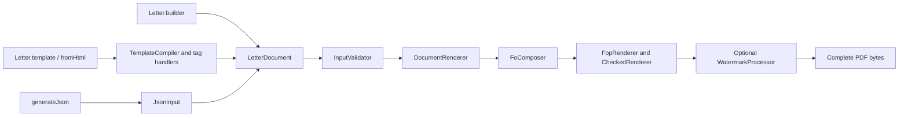

# Working on Letter Generator

Use JDK 17 and the checked-in Maven Wrapper. Run `./mvnw spotless:apply` before `./mvnw clean verify`. `verify` enforces formatting, `-Xlint:all -Werror`, tests, and Checkstyle.

## Where to start reading

Start with [Letter](src/main/java/com/nsdev/lettergenerator/Letter.java) and [LetterPdfGenerator](src/main/java/com/nsdev/lettergenerator/LetterPdfGenerator.java). The first creates builders; the second validates a completed model and renders PDF bytes. Building a model and rendering it are separate operations.



Follow these paths according to the code you are changing:

1. **Java construction.** [LetterBuilder](src/main/java/com/nsdev/lettergenerator/builder/LetterBuilder.java) collects ordered body content and replaceable regions. Its `build()` resolves final dimensions and returns the immutable [LetterDocument](src/main/java/com/nsdev/lettergenerator/model/LetterDocument.java). Model constructors supply defaults and copy collections/images; the full document is validated when generation is requested.
2. **HTML construction.** [HtmlLetterBuilder](src/main/java/com/nsdev/lettergenerator/builder/HtmlLetterBuilder.java) owns source, values and assets. [TemplateCompiler](src/main/java/com/nsdev/lettergenerator/internal/template/TemplateCompiler.java) parses the root, substitutes literal values, reads page settings and dispatches the registered region handlers. A handler configures the same Java builder used by ordinary Java construction. Nested paragraphs, inline styles, tables and images are converted by `internal.markup`. Compilation produces a model, never Java source code.
3. **JSON construction.** [JsonInput](src/main/java/com/nsdev/lettergenerator/internal/json/JsonInput.java) performs strict JSON-to-model mapping. It rejects unknown fields, duplicate keys and trailing content. It then shares the same model validation/rendering path as the other APIs.
4. **Validation.** [InputValidator](src/main/java/com/nsdev/lettergenerator/internal/validation/InputValidator.java) coordinates page geometry, styles/fonts, block structure, fixed-box collisions, signature configuration and watermark input checks. Helpers preserve field paths such as `sections[0].blocks[1]`. This stage cannot determine actual pagination or painted glyph bounds; those require rendering.
5. **Rendering.** [DocumentRenderer](src/main/java/com/nsdev/lettergenerator/internal/render/DocumentRenderer.java) orchestrates the engine stages. [FoComposer](src/main/java/com/nsdev/lettergenerator/internal/render/fo/FoComposer.java) serializes the model into XSL Formatting Objects, an XML layout vocabulary. [FopRenderer](src/main/java/com/nsdev/lettergenerator/internal/render/fop/FopRenderer.java) invokes Apache FOP, the engine that lays out that document and creates PDF bytes. [CheckedRenderer](src/main/java/com/nsdev/lettergenerator/internal/render/fop/CheckedRenderer.java) checks actual glyph/underline ink and records the page masters selected by FOP.
6. **Acceptance and decoration.** Engine results are internal until diagnostics are accepted. A positive signature reservation permits one retry for body overflow or a missing reserved final-page master. Other failures are terminal. Only after layout succeeds does [WatermarkProcessor](src/main/java/com/nsdev/lettergenerator/internal/render/watermark/WatermarkProcessor.java) optionally use PDFBox to prepend watermark content to selected pages.

### Finding the owner of a change

| Change or question | Start here |
| --- | --- |
| Public fluent calls, append/replace behavior | `builder.LetterBuilder`, `builder.TableBuilder`, `builder.HtmlLetterBuilder` |
| Meaning of a field, default or physical unit | The record/enum in `model.*`; its Javadoc documents components and validation timing |
| New top-level HTML region | `internal.template.TemplateTagRegistry` and the corresponding `*TagHandler` |
| Nested HTML tags or CSS properties | `internal.markup.HtmlBlocks`, `InlineReader`, `HtmlTables`, `HtmlStyles` |
| Header placement, logo gaps, reserved zones | `internal.builder.HeaderLayout`, `LetterRegions`; `model.layout.*` |
| Text spacing, table painting, page-master XML | `internal.render.fo` |
| Unexpected extra page or rejected/clipped glyphs | `DocumentRenderer`, `FopRenderResult`, `CheckedRenderer` |
| Registered fonts or allowed resource loading | `internal.font`, `internal.resource`, `FopConfiguration` |

Each production package has a `package-info.java` describing its role and neighboring components. Read the class overview first, then the method contract: defaults, units, null behavior, mutation/ownership and failure timing are documented where the operation is defined. Constants belong to the class that owns their meaning.

### Browsing and checking Javadocs

Use **JDK 17's** `javadoc` command from the repository root. This generates browsable documentation for public and internal code, including private helpers, and treats documentation warnings as failures:

```sh
./mvnw dependency:build-classpath -DincludeScope=runtime -Dmdep.outputFile=target/classpath.txt
javadoc --release 17 -private -Xdoclint:all -Werror \
  -classpath "$(cat target/classpath.txt)" \
  -sourcepath src/main/java -subpackages com.nsdev.lettergenerator \
  -d target/apidocs
```

Open `target/apidocs/index.html` to browse it, or use your IDE's documentation hover/navigation directly on the source. Generated documentation stays under the ignored `target` directory. Update method and package documentation when their contracts change; comments must describe current behavior rather than proposed features.

## Conventions

- Four-space AOSP Java formatting, explicit imports, and braces on control-flow bodies. The formatter includes tests and examples; Checkstyle includes production and test source.
- Keep the supported contract in the root entry points, `builder`, `signature`, model subpackages, `font`, and `exception`. Do not expose engine types through public signatures. Everything under `internal` may change independently of that contract.
- Put a domain constant beside its owner: paper dimensions on `PageSize`, default styles on `ResolvedStyle`, physical conversions on `Units`, glyph tolerance on the glyph checker. XML element/property names and field paths remain readable schema vocabulary. Do not replace obvious arithmetic with meaningless constants.
- Keep one responsibility per class. Composition, page/master layout, block/style serialization, engine configuration, resource access, validation, and post-processing are separate units. Avoid cyclic package dependencies.
- Use structured XML serialization. Document content is always data. Resource URIs are generated internally and resolved through the per-call memory allowlist.
- Catch expected input errors narrowly. Engine boundary wrappers preserve causes. Recovery decisions use diagnostic types and context, never matching localized exception messages.
- Preserve immutable ownership of lists, images, and loaded font bytes. Mutable engine state belongs to one generation call. Array-backed value records must implement content-based equality and hashing.
- Reuse fixtures from `src/test/java/com/nsdev/lettergenerator/fixtures`, not from test classes. Write regressions around observable behavior. Fixture numbers remain literal to keep expected values independent of production constants.

New dependencies, build plugins, and formatting engines must have pinned versions. The narrow raw-list suppression on the FOP callback exists because the pinned upstream API uses that signature; it is not a general warning exemption.

Convenience builders compile to the existing immutable model; keep rendering in the shared engine. Use typed methods rather than `Object...`, preserve insertion order and immutable build snapshots, and keep default dimensions beside their owning builder/type. Plain body text distinguishes line breaks, paragraphs and explicit page breaks; page breaks belong only in body sections.

Template markup uses jsoup for structure and map-only StringSubstitutor for parsed text/attribute values. Preserve literal value ownership, reject unsupported constructs with locations, and route every region through the existing block/renderer contract. Keep internal.markup independent of public builders; internal.template performs document composition. Template footers and headers support the same styled text/image/table blocks as the body.

## Adding a template region

`TemplateCompiler` coordinates root parsing, placeholder binding, page options and handler dispatch. Top-level tags inside `letter` are compiled by stateless `TemplateTagHandler` implementations in `internal.template`: `MainTagHandler`, `HeaderTagHandler`, `FooterTagHandler`, `LogoTagHandler`, `SignatureTagHandler` and `WatermarkTagHandler`.

To add a top-level tag to the library:

1. Implement `TemplateTagHandler` in the same package. Return the lowercase tag name from `tagName()`; override `required()` only when every letter must include it.
2. In `handle(Element, TemplateContext)`, validate the tag's attributes and content with `MarkupSupport`, then contribute to the per-call builder. Keep its defaults and tag-specific rules in this handler. Use `TemplateBlocks` for existing styled text/image/table content and `TemplateImages` for a single-image region.
3. Add one handler instance to `TemplateTagRegistry.standard()`. Registration order defines execution order, independently of source order. Preserve the logo's early sizing before header layout. The registry derives its supported vocabulary from registrations and rejects unknown tags, duplicate source regions, missing required regions and duplicate handler registrations.
4. Add tests for the new region's observable model/PDF output, invalid inputs, styles/assets and interactions with existing regions. Update the supported markup instructions in README.md.

Handlers receive `TemplateContext` for the current builder, parsed `TemplatePage` and named assets. Do not retain or mutate input nodes/assets or store per-letter state in handlers: the immutable registry is reused across compilation calls. Shared content readers preserve the existing markup validation and asset allowlist.

This registry covers top-level letter regions. Tags nested inside a region belong to `internal.markup` (`HtmlBlocks` for blocks, `InlineReader` for inline formatting). These are internal development extension points; the supported application API remains `Letter.template(...)` / `Letter.fromHtml(...)`.

## Layout and documentation

Resolve header geometry only after final page, margin and fitted-logo settings. Use the shared geometry tolerance for floating-point boundaries, preserve automatic logo gaps, and keep exact box placement independent of content alignment. Public convenience APIs and template attributes must have matching instructions in [README.md](README.md) and runnable examples. The default generator uses PDF standard fonts; do not describe test-only font files as bundled production resources.

Maintain the complete user guide in README.md. Keep internal plans and implementation notes in the ignored docs/ directory.
